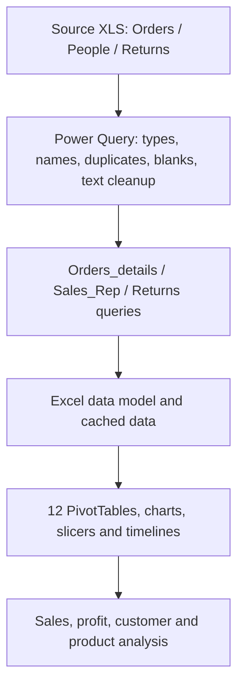

# Superstore Sales & Profit Performance

An Excel analysis project connecting raw sales transactions, Power Query preparation, a data model and interactive reporting.

**Tools:** Microsoft Excel, Power Query, Power Pivot, PivotTables, PivotCharts, slicers and timelines.


## Business questions

- Which products, customers and regions contribute profit?
- How does profit change across years and quarters?
- How do sales scale and profitability differ across categories and customer segments?
- Which returned products deserve further investigation?

## Project architecture




This is the evidenced processing flow, not a claim that every relationship or filter has been validated. See the [architecture guide](docs/ARCHITECTURE.md) for the file responsibilities and refresh path.

## Technical work

The workbook contains three Power Query queries. `Orders_details` removes Row ID, converts dates, renames columns, removes duplicates and blank rows, replaces missing postal codes, trims text and assigns numeric types. `Sales_Rep` reads the People sheet. `Returns` reads the Returns sheet and removes duplicates. The exact extracted queries are preserved in [Section1.original.m](power-query/Section1.original.m).

The report uses an embedded Excel data model, 12 PivotTables, charts, slicers and timelines. These let the user move between customer, product, region, category and time views. The supplied video visibly demonstrates changing filters and corresponding dashboard views; it does not by itself establish that every connection or calculation is correct.

## What the saved view suggests

In the supplied overview, Technology contributes the largest category share of profit and the Consumer segment contributes the largest segment share. These are observations about this saved view, not universal findings about every filter state.

For a business discussion, compare revenue with profit rather than ranking products only by sales. Investigate product mix, returned transactions and discounting before recommending stock, pricing or customer actions. These are proposed next analyses, not measured improvements or causal findings.

## Metric and reconciliation notes

The screenshot preserves the original labels and values, including Total Order 9,193, AVG Order 28.6 and margin 12.4%. These labels are not treated as corrected or validated definitions.

- The supplied raw Orders sheet contains 9,994 populated order lines and 5,009 distinct order IDs. Its used range also has five trailing blank/incomplete rows, including one with only a ship date.
- The workbook's cached Orders_details table also contains 9,994 rows and 5,009 distinct order IDs. Those matching counts do **not** prove the datasets are identical: their order-ID sets and sales/profit totals differ.
- The raw source totals are sales 2,297,200.8603 and profit 286,397.0217. Cached workbook totals are sales 2,296,919.4883 and profit 286,409.0805. They must be reconciled before reporting a newly refreshed result.
- The source has four People rows and 800 Returns rows. The cached Returns model table inspected here contains no rows. Check load settings, relationships and return logic in native Excel before making return-based claims.
- Confirm whether each order card counts distinct order IDs or lines, and define the numerator and denominator of every average and margin.
- Screenshots and video show historical states. Native refresh and every filter connection still require testing.

No calculation or workbook defect has been silently fixed in this repository.

## Files

```text
superstore-excel-analysis/
├── README.md
├── data/raw/Sample - Superstore 2019.xls   # Original supplied source
├── workbook/Superstore_Sales_Profit.xlsx  # Original supplied dashboard
├── power-query/Section1.original.m        # Extracted exact query source
├── images/                               # Five supplied screenshots
├── docs/                                 # Architecture, validation, file manifest
└── video/                                # Full original demo in repository package
```

- [Open/download the dashboard workbook](workbook/Superstore_Sales_Profit.xlsx)
- [Open/download the source workbook](data/raw/Sample%20-%20Superstore%202019.xls)
- [Power Query source](power-query/Section1.original.m)
- [Validation notes](docs/VALIDATION.md)
- [Full file manifest](docs/FILE_MANIFEST.json)

## Open and refresh

1. Download the source XLS and dashboard XLSX. Use Microsoft Excel desktop with Power Query and Power Pivot support.
2. Open the dashboard. Before refreshing, inspect **Data > Queries & Connections** and each query's source step.
3. The original queries point to `D:\Min_Progect\Sample - Superstore 2019.xls`. Repoint all three queries to your local copy in `data/raw/`. The original workbook and extracted query file remain unchanged for provenance.
4. Inspect the data model, Returns load settings, measures and filter connections. Resolve the source-versus-cache differences listed above.
5. Refresh, record the resulting row counts and totals, then test each slicer/timeline against a known subset.
6. Save a separately named validated copy if you make corrections. Do not overwrite the original without keeping its provenance.

## Screenshots and demo


The original 47.8-second MP4 is 37,527,684 bytes. It is preserved in the project package. GitHub browser repository uploads allow 25 MiB per file, so the full original will be attached to a GitHub Release after publication approval. Its actual verified release link will be added here after upload. It will not be silently omitted or split into fragments viewers cannot play.

## Data and use

This project is presented as portfolio analysis, not client employment or proven commercial impact. Source provenance and redistribution permission must be confirmed before the source workbook or cached customer/order data is published. No blanket third-party data license is granted by this README.
